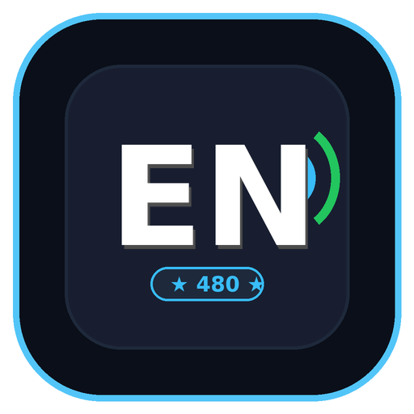
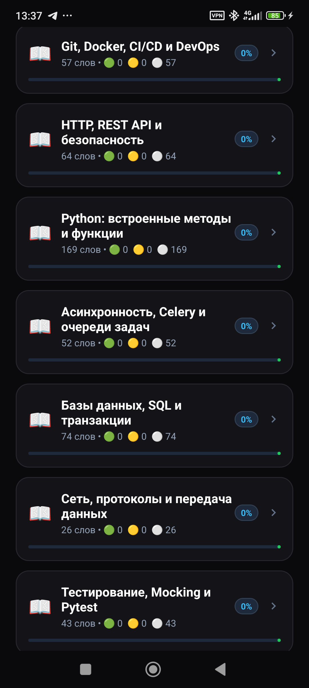
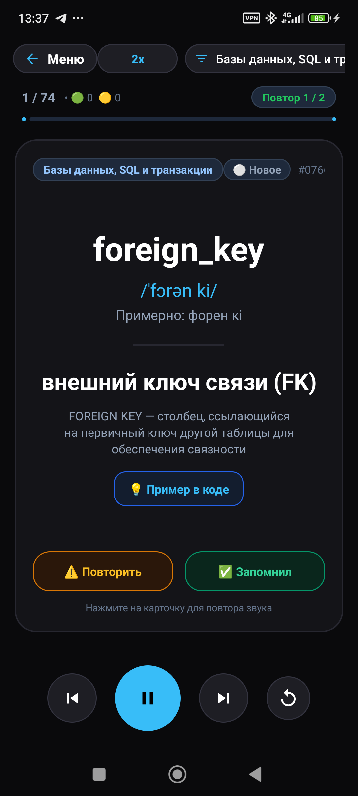

# 📱 English Flashcards — IT, Backend & Workplace English (v3.0)

<p align="center">
  
</p>

<p align="center">
  <b>Профессиональное Android-приложение для изучения IT, Backend и профессионального английского языка методом научно обоснованного интервального повторения FSRS v4.5 с активным вспоминанием (Active Recall), чистой озвучкой Andrew и реальными примерами кода.</b>
</p>

<p align="center">
  
  
  
  
  
  
  
  
  
</p>

---

## 📸 Скриншоты интерфейса

<table align="center" width="100%">
  <tr>
    <th width="33%" align="center">🏠 Меню и FSRS статистика</th>
    <th width="33%" align="center">🃏 Активное вспоминание (Active Recall)</th>
    <th width="33%" align="center">💡 Технические детали и реальный код</th>
  </tr>
  <tr>
    <td align="center">
      
    </td>
    <td align="center">
      
    </td>
    <td align="center">
      
    </td>
  </tr>
  <tr>
    <td align="center"><i>Очередь повторения на сегодня, FSRS-метрики и категории</i></td>
    <td align="center"><i>Лицевая сторона со скрытым ответом, педагогический разбор и 4 FSRS оценки</i></td>
    <td align="center"><i>Реальные сниппеты (Python 3.12 / Django / FastAPI) с кнопкой копирования</i></td>
  </tr>
</table>

---

## 🌟 Ключевые возможности версии 3.0

- 🧠 **Алгоритм интервального повторения FSRS (v4.5):**
  - Математически доказанная модель забывания на основе стабильности и сложности памяти.
  - Раздельный учет навыков: распознавание (`EN → RU`), активное воспроизведение (`RU → EN`), аудирование и написание.
  - 4 кнопки интервальной оценки: **«Не вспомнил» (Again)**, **«Трудно» (Hard)**, **«Вспомнил» (Good)**, **«Легко» (Easy)** с мгновенным предпросмотром интервала (`< 1м`, `5м`, `10м`, `3д`).
- 👁 **Режим активного вспоминания (Active Recall):**
  - Никакого пассивного подглядывания: на лицевой стороне отображается только термин или вопрос.
  - Перевод, произношение, педагогический разбор и код скрыты до явного нажатия кнопки **«👁 Показать ответ»**.
- 📚 **1 680 выверенных единиц контента:**
  - 1 530 технических карточек: Python builtins, Django ORM, FastAPI, Pydantic, SQL, Celery, Redis, Docker, Git, IoT.
  - 150 единиц повседневного и делового английского (глаголы, фразовые глаголы, деловые обороты, связки, состояния).
  - 50 вторичных контекстных примеров для глубокого понимания многозначных слов.
  - **0 шаблонных заглушек:** полностью исключены искусственные классы `*Service` и шаблонные описания.
- 🎓 **12 интерактивных микроуроков грамматики (`content/lessons/`):**
  - Артикли в IT (`a/an` vs `the`), исчисляемость (`data`, `code`, `information`), глаголы действия (`do` vs `make`), коммуникация (`say` vs `tell`), фразовые глаголы (`look at / for / into`), управление предлогами (`depend on`), модальные глаголы, вежливые просьбы, порядок слов и времена.
  - Каждый урок включает лаконичное правило, живые примеры и ровно 3 тестовых мини-упражнения.
- 🎙 **Студийная озвучка Andrew без запеченных циклов:**
  - Голос `en-US-AndrewMultilingualNeural` сохранен как эталон.
  - Одиночные независимые аудиосегменты: кнопки «🔊 Слово» и «🔊 Фраза» звучат изолированно.
  - Точный аппаратный счетчик циклов повторения в плеере.
  - Входные хеши (SHA-256) и манифест `audio_manifest.json` гарантируют актуальность файлов после правок текста.
  - Нормализация пиковой громкости до −1.0 dBFS.
- 💾 **Полноценная база данных Room (SQLite):**
  - Таблицы `practice_states`, `review_events`, `user_entry_states`.
  - Автоматическая бесшовная миграция сохраненного прогресса из прежних версий SharedPreferences.
- ☀️ **Режим бодрствования экрана:**
  - Во время активного изучения карточек экран устройства не гаснет (`FLAG_KEEP_SCREEN_ON`). При паузе или возврате в меню флаг автоматически снимается для экономии батареи.
- ⚡ **100% Офлайн:**
  - Работает автономно в авиарежиме без запросов во внешнюю сеть.

---

## 🛠 Архитектура и стек технологий

- **Платформа:** Android 8.0+ (API 24 - 35)
- **Язык разработки:** Kotlin 2.0 / Java 17
- **База данных:** AndroidX Room 2.6.1 (SQLite) + Kotlin Kapt
- **Асинхронность:** Kotlin Coroutines & LifecycleScope
- **Интервальное повторение:** FSRS v4.5 Scheduler (Open Spaced Repetition)
- **UI:** Material Components 3, ViewPager2, BottomSheetDialog, ViewBinding
- **Аудио:** Android MediaPlayer с сегментной оркестрацией и AssetFileDescriptor

---

## 🧪 Запуск тестов и валидация

```bash
# 1. Валидация контента и JSON Schema (Python 3.12+)
python3 scripts/validate_content.py

# 2. Запуск тестового набора pytest
pytest tests/

# 3. Валидация аудиофайлов и манифеста
python3 scripts/validate_audio.py

# 4. Модульные тесты Android (FSRSScheduler, Room)
cd app_english_cards && ./gradlew testDebugUnitTest

# 5. Сборка Debug APK
cd app_english_cards && ./gradlew assembleDebug
```
